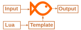

# bafi

**Convert JSON, XML, CSV, YAML, BSON and MT940 into any text format with templates.**

One small command-line program for Windows, macOS and Linux. Read a file or a pipe, describe the output
with a Go template, get JSON, XML, CSV, HTML, SQL, a SOAP request - anything that is text.

```sh
bafi -i orders.xml -t '?{{toJSON .}}'                              # XML to JSON
bafi -i users.csv -d ';' -t '?{{toJSON .}}'                        # CSV (semicolon) to JSON
curl -fs https://example.com/api/users | bafi -f json -t '?{{toXML .}}'   # REST response to XML
bafi -i sales.json -t report.tmpl -o report.html                    # HTML report from a template
```

**[Documentation](https://mmalcek.github.io/bafi/)** ·
**[Recipes](https://mmalcek.github.io/bafi/recipes/)** ·
**[Install](https://mmalcek.github.io/bafi/install/)** ·
**[Download](https://github.com/mmalcek/bafi/releases/latest)** ·
[Changelog](CHANGELOG.md)



## Recipes

Step-by-step, tested examples for common tasks:
[XML to JSON](https://mmalcek.github.io/bafi/recipes/xml-to-json/) ·
[JSON to XML](https://mmalcek.github.io/bafi/recipes/json-to-xml/) ·
[CSV to JSON](https://mmalcek.github.io/bafi/recipes/csv-to-json/) ·
[JSON to CSV](https://mmalcek.github.io/bafi/recipes/json-to-csv/) ·
[XML to CSV](https://mmalcek.github.io/bafi/recipes/xml-to-csv/) ·
[REST to SOAP](https://mmalcek.github.io/bafi/recipes/rest-to-soap/) ·
[SOAP to JSON](https://mmalcek.github.io/bafi/recipes/soap-to-json/) ·
[HTML report](https://mmalcek.github.io/bafi/recipes/json-to-html/) ·
[SQL INSERTs from CSV](https://mmalcek.github.io/bafi/recipes/csv-to-sql/) ·
[MT940 to CSV](https://mmalcek.github.io/bafi/recipes/mt940-to-csv/) ·
[Merge several files](https://mmalcek.github.io/bafi/recipes/merge-files/) ·
[more](https://mmalcek.github.io/bafi/recipes/)

## Key features

- Input: **JSON, BSON, YAML, CSV** (any delimiter), **XML** and **MT940** bank statements, from a file or
  standard input; several files of different formats can be merged into one output.
- Output: whatever the template produces. 60+ template functions for math, dates, strings and
  conversions, plus your own in [Lua](https://mmalcek.github.io/bafi/recipes/lua/).
- Errors point at the file, line and column, with a hint how to fix them.
- Encode data as **TOON** for LLM prompts, or ask **OpenAI** about your data (experimental).
- [Try it in the browser](https://mmalcek.github.io/bafi/#try-it-online) without installing anything.

[](https://github.com/mmalcek/bafi/actions/workflows/go.yml)
[](https://github.com/mmalcek/bafi/actions/workflows/codeql-analysis.yml)
[](https://goreportcard.com/report/github.com/mmalcek/bafi)
[](https://github.com/mmalcek/bafi/blob/main/LICENSE)
[](https://github.com/avelino/awesome-go#text-processing)
[](https://github.com/mmalcek/bafi/releases/latest)

**If you like this app you can buy me a coffee ;)**

<a href='https://ko-fi.com/mmalcek' target='_blank'>
	
</a>
